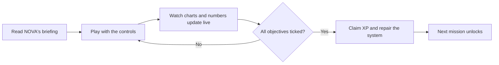

# 🚀 STARFALL: A Data Science Adventure

> Learn core data-science concepts by playing a story-driven space game, built with Streamlit.

A solar storm has scrambled every system on the starship **Meridian**. You are the last Data Officer awake,
and the ship's AI, **NOVA**, needs your judgement to repair four systems. Each repair teaches one real
data-science skill through hands-on, interactive play, with no code and no maths prerequisites.

## 🎮 Missions

| # | Mission | Concept | What you do |
|---|---------|---------|-------------|
| 1 | 🧹 **Signal Scrub** | Data cleaning | Handle missing values (NaN), remove outliers with z-scores, rescale features, without throwing away good data. |
| 2 | 🎯 **Threat Scanner** | Classification | Move the alarm threshold on a real dataset and watch precision, recall, the confusion matrix and the ROC curve react. |
| 3 | 🌀 **Orbit Tuner** | Regression | Tune polynomial degree and Ridge/Lasso regularization to escape under- and overfitting. |
| 4 | 🛸 **Fleet Finder** | Clustering | Use K-Means, the elbow chart and silhouette score to discover how many hidden fleets exist. |

### Game mechanics
- **XP and ranks:** Cadet → Navigator → Analyst → Specialist → Commander.
- **Objectives:** each mission has a checklist; complete it to claim 100 XP.
- **Progression:** missions unlock in order; the final debrief unlocks after all four.
- **Hints:** ask NOVA for help at a cost of 20 XP (a no-hint run earns the "Perfect run" badge).
- **Field Manual:** a plain-language explanation of the concept sits under every mission.

## 🧭 How the game works

Every mission follows the same loop:



- **Left panel:** the controls (sliders, dropdowns, buttons) that you change.
- **Right panel:** charts that redraw instantly, so you see the *effect* of each choice.
- **Objectives checklist:** turns green as you meet each goal. When all are green, a **Claim XP** button appears.
- **Sidebar:** shows your rank and XP, and lets you jump between missions. ✅ means done and 🔒 means locked.
- **State:** progress is kept in your browser session. It resets if you press *Restart game* or start a new session.

There is no way to lose or die. Experimenting is the point: **try extreme settings on purpose** to see what breaks.

## 📖 Beginner's guide: how to play

### Getting started
1. Launch the game (`streamlit run app.py`) and read the **Prologue**.
2. Click **🚀 Begin Mission 1**.
3. Read what **NOVA** (the ship AI) says. It explains the problem in plain words.
4. Change one control at a time and watch what happens.
5. If you are stuck, open the **📘 Field Manual** under the mission, or use **💡 Ask NOVA for a hint** (costs 20 XP).
6. When every objective is ticked, press **⭐ Claim XP**, then **Next mission ➜**.

### Mission 1: Signal Scrub (data cleaning)
**Goal:** recover the true wave from a corrupted signal.

| Control | What it does |
|---------|--------------|
| Missing readings | `Leave them`, `Drop those rows`, or `Fill with average` |
| Outlier cutoff (σ) | Removes points further than this many standard deviations from the average. `4.0` means the filter is off. |
| Rescale | Changes the units of the data (does not change its shape) |

**Look at:** grey dots are the raw feed, the dotted purple line is the hidden true signal, and cyan dots are your cleaned data.

**Objectives:** no missing values, all 3 wild outliers removed, and at most 3 good readings lost.

<details>
<summary>🔍 Spoiler: walkthrough</summary>

Choose *Drop those rows* or *Fill with average*, then lower the cutoff slowly. Around **2 to 3σ** removes the outliers while keeping the real wave. At about 1σ you start deleting real data, which is the trade-off this mission teaches.
</details>

### Mission 2: Threat Scanner (classification)
**Goal:** set an alarm threshold so almost no real threat is missed *and* there are few false alarms.

| Control | What it does |
|---------|--------------|
| Preset buttons | 😱 Paranoid (0.10), ⚖️ Balanced (0.50), 😴 Relaxed (0.90) |
| Alarm threshold (τ) | A scan triggers the alarm when its threat probability is at least τ |

**Key ideas:**
- **Precision:** when the alarm sounds, how often is it a real threat?
- **Recall:** of all real threats, how many did we catch?
- Lowering τ raises recall but lowers precision, and raising τ does the opposite. You cannot maximise both for free.

**Tabs:** *Scanner readings* (histogram with the alarm line), *Scan grid* (150 scans as tiles), *Confusion matrix*, and *ROC curve* (your threshold is the yellow dot).

**Objectives:** recall ≥ 97% and precision ≥ 96%.

<details>
<summary>🔍 Spoiler: walkthrough</summary>

Start with the 😱 and 😴 presets to feel both extremes, then fine-tune the slider. A threshold between roughly **0.30 and 0.55** satisfies both objectives.
</details>

### Mission 3: Orbit Tuner (regression)
**Goal:** fit a curve that predicts *unseen* data well.

| Control | What it does |
|---------|--------------|
| Polynomial degree | How flexible the curve is (1 = a straight line) |
| Regularization | `None`, `Ridge (L2)` or `Lasso (L1)`: a brake on over-complex curves |
| Brake strength (λ) | How hard the brake pushes |

**Look at:** cyan dots are training data (the model sees them), yellow diamonds are test data (it never sees them). The banner tells you whether you are *underfitting*, *overfitting*, or in the *sweet spot*.

**Objective:** get the **test error** at or below the target shown on screen.

<details>
<summary>🔍 Spoiler: walkthrough</summary>

Degree 1 underfits. Raise the degree until the curve follows the wave. At very high degrees the curve wiggles to hit every training point (overfitting) and test error rises, so add some Ridge strength to calm it down.
</details>

### Mission 4: Fleet Finder (clustering)
**Goal:** discover how many groups hide in unlabelled data.

| Control | What it does |
|---------|--------------|
| Number of fleets (K) | How many clusters K-Means looks for |

**Tabs:** *Radar* (the clustered points), *Elbow chart* (look for the bend), and *Silhouette chart* (the tallest bar is the best K).

**Objective:** choose the K with the best silhouette score.

<details>
<summary>🔍 Spoiler: walkthrough</summary>

Both the elbow bend and the tallest silhouette bar point to **K = 4**.
</details>

### Scoring

| Event | XP |
|-------|----|
| Complete a mission | +100 |
| Complete it after using a hint | +80 |
| Perfect run (400 XP, no hints) | 🏅 badge in the debrief |

### Tips for beginners
- Change **one control at a time** so you can tell what caused each change.
- Push controls to the extremes first, then back off.
- Hover over metrics that have a ❓ icon for a definition.
- Read the **Field Manual** after you win. It names the concept you just practised.
- You can replay any completed mission to experiment freely.

## 🖼️ Screenshots

Add screenshots to `docs/` and reference them here, for example:

```markdown

```

## 🛠️ Installation

**Requirements:** Python 3.10 or newer.

```bash
# 1. Clone the repository
git clone https://github.com/<your-username>/<your-repo>.git
cd <your-repo>

# 2. (Recommended) create a virtual environment
python3 -m venv .venv
source .venv/bin/activate        # Windows: .venv\Scripts\activate

# 3. Install dependencies
pip install -r requirements.txt

# 4. Launch the game
streamlit run app.py
```

Streamlit opens the game at <http://localhost:8501>.

## 📁 Project structure

```
.
├── app.py                  # The whole game (UI, story, missions, models)
├── requirements.txt        # Python dependencies
├── .streamlit/config.toml  # Dark theme + disables usage telemetry
├── .gitignore
└── README.md
```

### How `app.py` is organised

| Section | Purpose |
|---------|---------|
| Page config & CSS | Layout, fonts, glass-card / neon styling |
| Game state | XP, completed missions, hints, navigation (`st.session_state`) |
| UI helpers | HUD, NOVA dialogue, objectives, hints, mission footer |
| Data/model caches | `@st.cache_data` functions that build each mission's dataset and models |
| Sidebar | Stage navigation with lock/complete icons |
| Stage blocks | One `if/elif` block per mission, then the debrief |

## 🧩 Extending the game

To add a mission:
1. Add an entry to the `STAGES` dictionary and update `is_unlocked` / the win-count logic.
2. Add a data function with `@st.cache_data`.
3. Add an `elif stage == N:` block using the helpers: `mission_header`, `nova`, `objectives`,
   `hint_box`, `mission_footer` and `manual`.

## 📚 Datasets and libraries

- **Dataset:** [UCI Breast Cancer Wisconsin (Diagnostic)](https://archive.ics.uci.edu/dataset/17), loaded through scikit-learn and reframed as "ship scans" in Mission 2. Other missions use synthetic data generated in code.
- **Libraries:** Streamlit, NumPy, pandas, Plotly, scikit-learn.

> This project is for education only. The dataset is real medical data, but the game is not a medical tool.

## 🐛 Troubleshooting

- **`streamlit: command not found`:** run `python3 -m streamlit run app.py`.
- **Fonts look different offline:** the Orbitron and Inter fonts load from Google Fonts and fall back to system fonts.
- **Progress lost on refresh:** progress lives in the browser session; use the sidebar's *Restart game* to reset it on purpose.

## 🤝 Contributing

Issues and pull requests are welcome. Please keep each mission focused on one concept and keep its objectives winnable.

## 📄 License

No license has been chosen yet. Add a `LICENSE` file (for example MIT) before sharing the project publicly.
